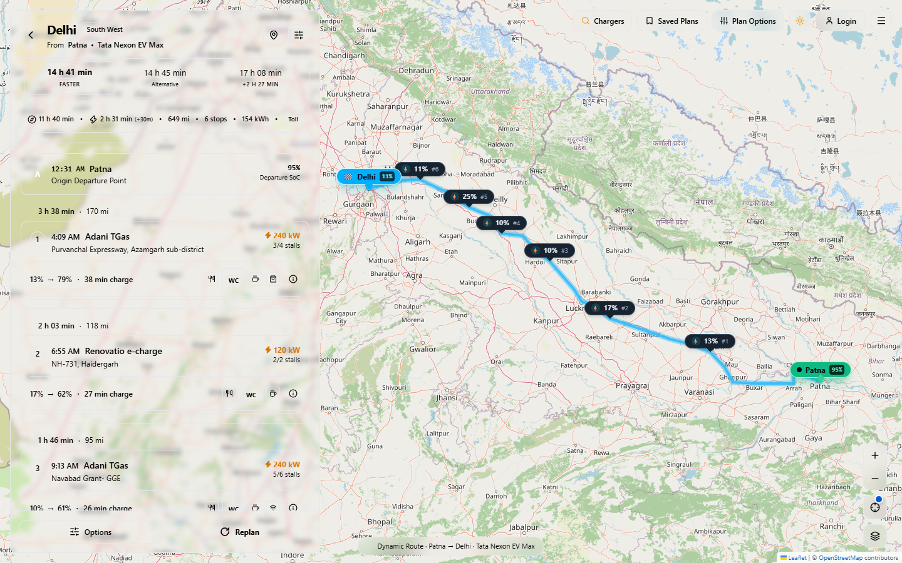
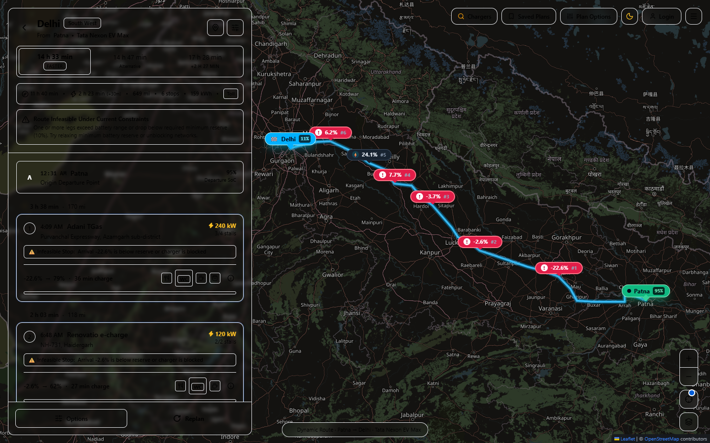
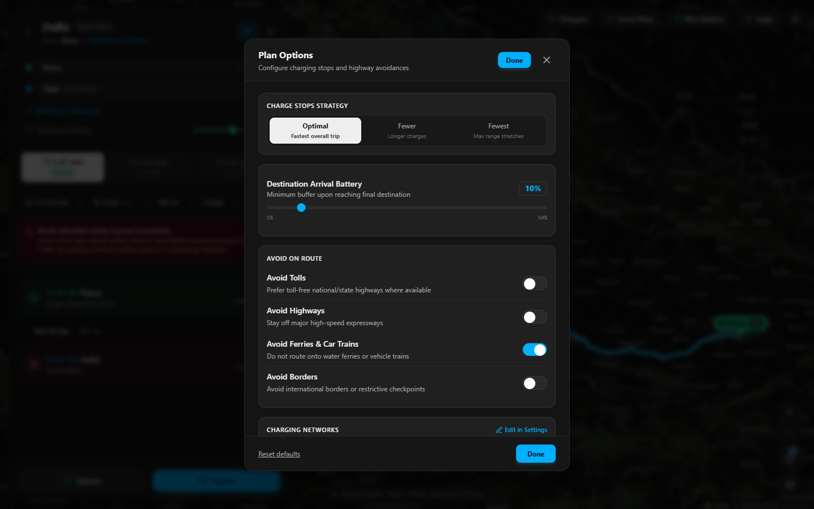
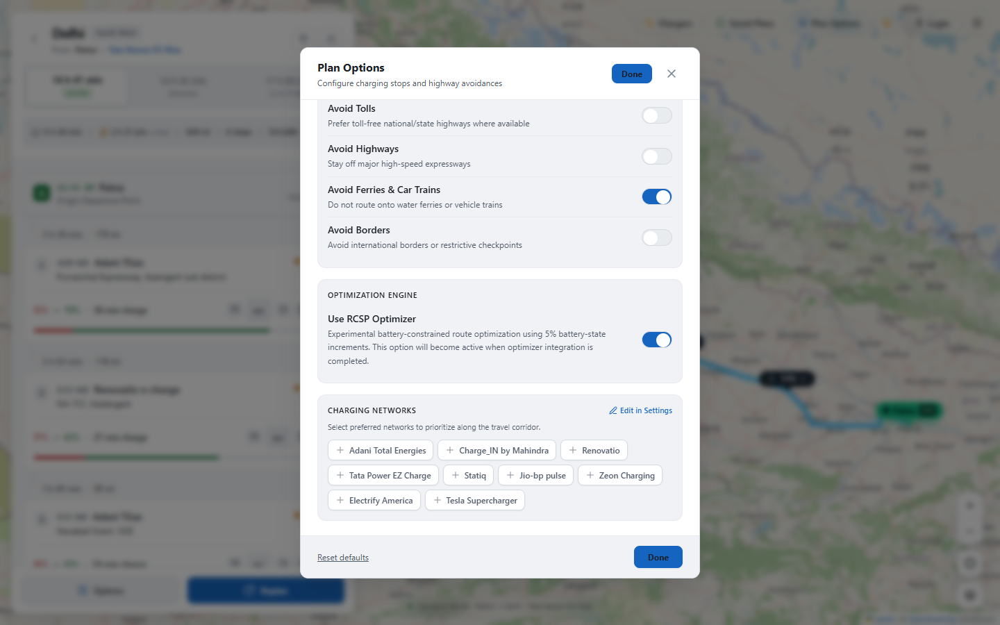
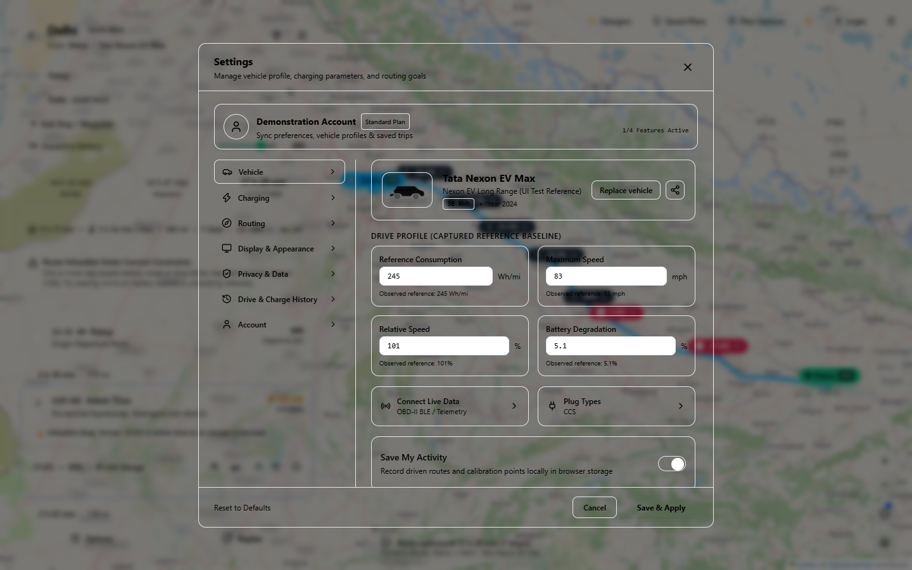
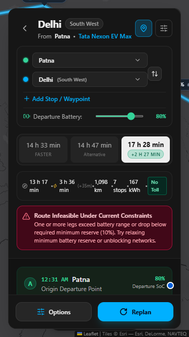
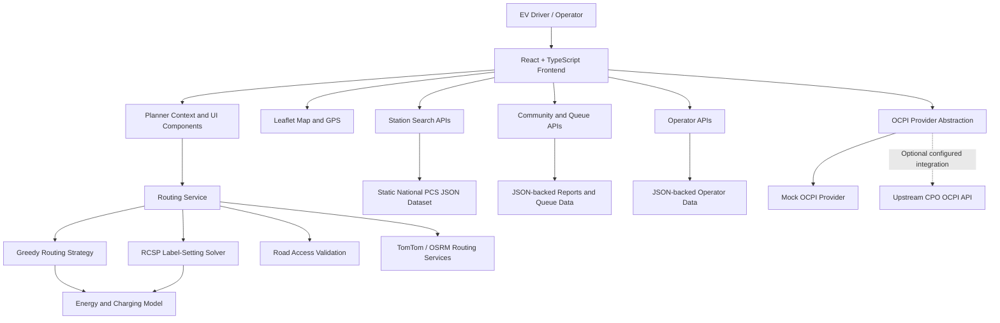

# EVSure — Reliability-Aware EV Route Optimization Platform for India

**Course:** Optimization Techniques  
**Project Type:** Academic software and optimization prototype  
**Platform:** Web application for electric-vehicle trip planning  
**Primary Focus:** Battery-constrained route planning, charging-stop selection, station information and reliability-aware journey planning  

EVSure is an India-focused electric-vehicle (EV) route-planning prototype. It combines an interactive trip planner with vehicle and battery models, road-routing services, charging-station discovery, charging-stop selection, community reports, queue estimates and an optimization engine. The central academic problem is to plan a feasible journey while accounting for the EV's limited battery capacity and the time and cost of intermediate charging.

> **Project scope and data disclaimer:** EVSure is an academic prototype. The national charging-station register included in the repository is a static dataset snapshot. Some station-catalogue entries, availability, queue and operator records are demonstration or simulated data. OCPI connectivity is implemented as an integration architecture, but the supplied project does not include a production connection to every Indian Charge Point Operator (CPO). The application must not be interpreted as a source of guaranteed live charger availability or manufacturer-certified range estimates.

---

## Contents

1. [Motivation and Background](#1-motivation-and-background)
2. [Problem Statement](#2-problem-statement)
3. [Project Objectives and Scope](#3-project-objectives-and-scope)
4. [Main Features](#4-main-features)
5. [User Workflow](#5-user-workflow)
6. [System Architecture](#6-system-architecture)
7. [Technology Stack](#7-technology-stack)
8. [Project Structure](#8-project-structure)
9. [Data Sources and Charging-Station Catalogue](#9-data-sources-and-charging-station-catalogue)
10. [Optimization Techniques](#10-optimization-techniques)
11. [Vehicle Energy and Charging Model](#11-vehicle-energy-and-charging-model)
12. [Community Reliability Model](#12-community-reliability-model)
13. [Queue Estimation and Operator Workflows](#13-queue-estimation-and-operator-workflows)
14. [Road Accessibility and Backup Charging](#14-road-accessibility-and-backup-charging)
15. [External Services and Integrations](#15-external-services-and-integrations)
16. [API Overview](#16-api-overview)
17. [Installation and Local Execution](#17-installation-and-local-execution)
18. [Testing and Verification](#18-testing-and-verification)
19. [Benchmark Results](#19-benchmark-results)
20. [Known Limitations](#20-known-limitations)
21. [Future Scope](#21-future-scope)
22. [Team Contributions](#22-team-contributions)
23. [References and Technical Resources](#23-references-and-technical-resources)

---

## 1. Motivation and Background

Electric vehicles are increasingly being used for personal travel, taxis and commercial transportation. For a conventional vehicle, route planning mainly considers the road network, distance, time and traffic. An EV journey has additional constraints because the vehicle carries a finite amount of stored energy and may need to stop at compatible charging stations along the way.

Long-distance EV travel introduces several connected challenges:

- **Range uncertainty:** The distance a vehicle can travel depends on its usable battery capacity, driving speed, temperature, vehicle condition and energy consumption.
- **Charging-stop selection:** A charger may be geographically close to the route but may have unsuitable connector types, insufficient power or an excessive detour.
- **Non-linear charging time:** Charging power generally changes with battery state of charge (SoC). Charging to a higher percentage can take disproportionately longer.
- **Fragmented charging information:** Stations are operated by different networks, and information about location, connector, tariff and operational status may be distributed across providers.
- **Uncertain station status:** A station listed in a directory is not necessarily working, available or accessible when a driver reaches it.
- **Queues and delays:** A charging stop may be occupied, and the time spent waiting can affect the overall trip.
- **Indian highway access conditions:** A station that appears close to a road on a map may be on the opposite carriageway or may require a service-road detour.

These challenges motivate a route planner that considers both the road journey and the charging decisions needed to complete it.

## 2. Problem Statement

A conventional shortest-path algorithm finds a path between an origin and destination using a road-related cost such as distance or driving time. It does not, by itself, ensure that an EV has enough battery energy to traverse every road segment or that a compatible charging stop is available when required.

EVSure addresses the following problem:

> Given an origin, destination, vehicle profile, initial battery state, minimum battery reserve and a set of candidate charging stations, determine a feasible sequence of road and charging stops that minimizes journey time, with charging expense and number of stops used as subsequent decision criteria.

The route must satisfy battery-capacity, battery-reserve, connector-compatibility and charging-power constraints. Station reliability information is used as an additional decision signal where evidence is available.

## 3. Project Objectives and Scope

### 3.1 Objectives

1. Build an interactive map-based EV trip-planning application.
2. Represent vehicle battery capacity, energy consumption, battery degradation and charging capability.
3. Identify charging stations along a candidate road route.
4. Select charging stops while maintaining battery feasibility.
5. Estimate charging energy, charging duration and charging expense.
6. Compare a forward greedy heuristic with a Resource-Constrained Shortest Path (RCSP) label-setting optimizer.
7. Incorporate station access metadata, community observations and backup-station reachability.
8. Provide station discovery, route alternatives, GPS progress and supporting operator/queue workflows.
9. Evaluate the optimization logic on deterministic benchmark scenarios and small instances checked against an exhaustive enumeration oracle.

### 3.2 Intended Users

- **Private EV drivers:** Plan personal intercity journeys, choose charging stops and inspect station information.
- **Commercial EV drivers/operators:** Explore trip planning with vehicle-specific energy requirements, queue information and operational context. Full fleet dispatch and multi-vehicle scheduling are future extensions, not the present core optimizer.
- **Charging-station operators:** Use the demonstration operator portal to inspect station, equipment, queue and session workflows.
- **Community contributors:** Submit observations about charger condition, availability, access and charging experience.

### 3.3 Scope Boundaries

The current prototype focuses on passenger EV route planning using a small curated charging catalogue together with a larger static Indian public-charging dataset for discovery and selected route workflows. It does not yet provide a continuously updated national operational database, universal CPO connectivity, in-app payment, charger reservation or production-grade fleet management.

---

## 4. Main Features

### 4.1 Interactive EV Trip Planner

- Origin and destination selection.
- Place search and reverse-geocoding support where a configured provider is available.
- Intermediate waypoints, including user-pinned charging stops.
- Origin/destination swap and waypoint editing/reordering.
- Vehicle selection and battery settings.
- Route alternatives with journey summaries and an itinerary.
- Map route geometry, origin/destination markers and charging-stop markers.

### 4.2 Vehicle and Battery Configuration

Vehicle profiles contain fields such as manufacturer, model, battery capacity, usable battery capacity, maximum DC/AC charging power, reference energy consumption, maximum speed, relative speed, battery degradation and supported connector types.

The bundled reference profiles include:

| Vehicle profile | Nominal capacity in seed data | Usable capacity in seed data | Maximum DC power in seed data |
|---|---:|---:|---:|
| Tata Nexon EV Max | 40.5 kWh | 38.0 kWh | 50 kW |
| Tata Punch EV LR | 35.0 kWh | 33.0 kWh | 50 kW |
| MG ZS EV Excite | 50.3 kWh | 48.0 kWh | 60 kW |
| Hyundai Ioniq 5 | 72.6 kWh | 70.0 kWh | 240 kW |

These are the values in the application's sample vehicle profiles. They are configuration inputs for the prototype and should not be treated as independently validated, trim-specific manufacturer specifications.

### 4.3 Route Alternatives and Itinerary

The planner can present alternatives such as:

- **Optimal/fastest strategy:** Uses a lower charging target to reduce time spent in the slower part of the charging curve.
- **Fewer stops:** Uses a higher target SoC to extend the distance covered between stops.
- **Fewest stops:** Prioritizes longer legs and fewer charging events, subject to feasibility.
- **RCSP option:** An optional label-setting optimization result can be enabled in Plan Options for supported custom routes.

Route summaries include distance, estimated driving duration, charging duration, stop buffers, estimated charging cost, stop count and estimated battery levels at stops.

### 4.4 Charger Finder and Station Explorer

The charger explorer provides station discovery and filtering capabilities, including:

- Search by name, operator or location text.
- State and other geographic filters where fields are available.
- Charging-network/operator filtering.
- Connector-type filtering and vehicle compatibility checks.
- Minimum charging-power filtering.
- Station details, tariffs, stall fields and amenities when present in the source record.
- Adding a selected charging station to the trip as a waypoint or pinned stop.

The nationwide station explorer and the small curated route-optimization catalogue are separate data sources; they should not be conflated.

### 4.5 Station Details and Preferences

Station details can include coordinates, address, operator/network, rated power, connectors, stall counts, tariff information, payment-method text, amenities, access metadata, source/provenance and community reliability summary.

User preferences include preferred and avoided charging networks, selected connector types, excluded chargers, route preferences, toll/highway/ferry avoidances, display units and appearance settings.


### 4.6 Queue Information and Smart Recommendations

The application can display reported or simulated queue status and estimate a wait at the expected arrival time. The recommendation service can consider waiting time together with charging duration, power, tariff and station information.

Queue predictions depend strongly on the provenance and freshness of queue observations. A simulated queue is illustrative and is not a live reading from a charger.

### 4.7 Operator Portal

The demonstration operator portal provides workflows for:

- Viewing an operator's managed stations.
- Searching the national catalogue for stations to claim.
- Managing operator organisations and station claims.
- Inspecting station equipment, EVSEs and connector hierarchy.
- Managing queue entries and calling the next vehicle.
- Assigning connectors and recording session start/completion.
- Viewing active sessions and aggregate queue reports.
- Handling driver check-ins.

The included operator records are demonstration data. The presence of these screens and API routes does not imply that real CPO accounts are connected.

### 4.8 GPS and Route Progress

The browser Geolocation API is used to obtain the driver's location when permission is granted. The client can display the current location, follow the vehicle, project the GPS position onto the planned route and estimate progress/remaining distance. GPS access depends on browser permissions and a secure context (localhost is treated as secure by modern browsers).

### 4.9 Saved Plans, Settings and Appearance

Selected planner settings, vehicle preferences, route preferences, display settings, drive history and saved plans are persisted in browser `localStorage`. This is browser-local persistence, not cloud synchronization between user devices.

### 4.10 Screenshots

The repository includes screenshots under `docs/screenshots/`.

**Main trip planner — light desktop**



**Main trip planner — dark desktop**



**Route and plan options**



**RCSP optimizer setting**



**Settings interface**



**Mobile planner**



---

## 5. User Workflow

1. The user selects an origin and destination and may add intermediate waypoints.
2. The user selects an EV profile and configures initial SoC and destination reserve.
3. The application requests road-route alternatives from the configured road provider or uses its documented fallback.
4. Candidate charging stations are identified along or near the route corridor.
5. Candidate stations are filtered using vehicle connector compatibility, power and user preferences; access metadata is checked where available.
6. The routing service calculates charging stops using the default greedy strategy and, when enabled for the custom route, the RCSP solver.
7. The energy model estimates battery consumption, charging energy and charging duration.
8. The route panel displays the selected route, alternatives, charging itinerary, estimated time/cost and battery levels.
9. Station details can show data provenance, community observations, queue information and a possible backup station.
10. The user may submit a community report or inspect route progress through GPS.

---

## 6. System Architecture

EVSure follows a modular client-and-server architecture. The React application owns the primary interface and much of the route-planning orchestration. API middleware and a standalone Node.js process provide station, places/traffic, queue, operator, report and OCPI-related endpoints.



### 6.1 Frontend

The React frontend is structured around reusable components, context state and service modules. It renders the trip planner, map, route panel, station explorer, dialogs, GPS controls, queue recommendations and operator portal.

### 6.2 Routing and Optimization Services

`routingService.ts` coordinates road-route alternatives, candidate station discovery, greedy routing, optional RCSP optimization and route feasibility validation. `rcspSolver.ts` contains the label-setting solver, while `energyModel.ts` calculates leg energy and charging duration.

### 6.3 API Layer

Vite middleware handles station, places/traffic, queue and operator API requests during development/preview. A separate Node HTTP server (`server/ocpiProxyServer.ts`) exposes station, report, live-station, route/traffic, places, queue and operator-related endpoints and protects upstream OCPI/TomTom credentials from the browser when configured.

### 6.4 Storage

The supplied implementation uses JSON files for national station records, community reports, queue reports and operator queue/session records. Browser settings and saved plans use `localStorage`. There is no PostgreSQL/PostGIS database in this version.

---

## 7. Technology Stack

| Layer | Technology | Role in EVSure |
|---|---|---|
| UI library | React 18 | Component-based user interface |
| Programming language | TypeScript | Typed frontend, service and server logic |
| Build/dev tooling | Vite 5 | Development server, middleware and production build |
| Styling | Tailwind CSS 3 and project CSS | Responsive styling and visual system |
| Map | Leaflet | Map layers, routes, markers and map interactions |
| Icons | Lucide React | Interface icons |
| Runtime | Node.js | API/proxy runtime and development tools |
| Server | Native Node.js HTTP + Vite middleware | HTTP endpoints and upstream proxying |
| Road routing | TomTom Orbis where configured; OSRM fallback | Road geometry, route duration and alternatives |
| Map/geospatial data | OpenStreetMap and Esri basemap option | Map tiles and geographic context |
| EV charging integration | OCPI 2.2.1/2.3.0 adapter architecture | Normalizing CPO locations, EVSEs, connectors, status and tariffs |
| Local persistence | JSON files and `localStorage` | Dataset/report storage and browser preferences |
| Unit/integration tests | Vitest | Automated application tests |
| Browser automation | Playwright scripts | End-to-end and visual verification scripts |

**Implementation note:** The package does not use Express or a SQL database. The standalone proxy is built using Node's native `http` module; Vite middleware also serves application APIs in development/preview.

---

## 8. Project Structure

The following is a high-level map of the important folders and files (generated assets and installed dependencies are omitted).

```text
.
├── index.html
├── package.json
├── vite.config.ts
├── tailwind.config.js
├── tsconfig.json
├── README.md
│
├── src/
│   ├── App.tsx
│   ├── main.tsx
│   ├── index.css
│   ├── components/
│   │   ├── charger/       # Charger finder and national station explorer
│   │   ├── common/        # Shared controls and modal components
│   │   ├── dialogs/       # Settings, reports, plan options, station details, etc.
│   │   ├── gps/           # GPS control panel
│   │   ├── location/      # Location search
│   │   ├── map/           # Leaflet map view
│   │   ├── operator/      # Operator portal and driver check-in
│   │   ├── queue/         # Queue and smart charging recommendations
│   │   ├── route/         # Route inputs, route panel and charging-stop cards
│   │   └── topbar/        # Top navigation
│   ├── context/
│   │   ├── PlannerContext.tsx
│   │   └── GpsContext.tsx
│   ├── data/
│   │   ├── demoRoute.ts
│   │   ├── demoSettings.ts
│   │   ├── demoVehicle.ts
│   │   ├── knownLocations.ts
│   │   └── stationCatalogue.ts
│   ├── services/
│   │   ├── routingService.ts
│   │   ├── rcspSolver.ts
│   │   ├── energyModel.ts
│   │   ├── roadAccessService.ts
│   │   ├── catalogueService.ts
│   │   ├── communityService.ts
│   │   ├── queue/
│   │   ├── providers/
│   │   ├── search/
│   │   ├── traffic/
│   │   └── benchmark/
│   ├── types/             # Route, station, vehicle, queue and report types
│   ├── utils/             # Geography, connector, time, unit and progress helpers
│   └── __tests__/         # Vitest suites
│
├── server/
│   ├── ocpiProxyServer.ts
│   ├── stationApiMiddleware.ts
│   ├── stationDataService.ts
│   ├── placesAndTrafficMiddleware.ts
│   ├── queueApiMiddleware.ts
│   ├── queueStorage.ts
│   ├── operatorApiMiddleware.ts
│   ├── operatorQueueStorage.ts
│   ├── reportStorage.ts
│   └── data/
│       ├── evPcsRawRecords.json
│       ├── evPcsStations.json
│       ├── communityReports.json
│       ├── communityQueueReports.json
│       └── operatorQueueData.json
│
├── scripts/               # Dataset import, benchmarks and diagnostic/E2E scripts
└── docs/
    ├── screenshots/
    ├── system-architecture.md
    ├── final-project-report.md
    ├── benchmark-methodology.md
    ├── benchmark-results.md
    ├── sensitivity-analysis.md
    ├── ev-pcs-import-report.md
    ├── implementation-status.md
    ├── limitations-and-future-work.md
    └── deployment-readiness.md
```

### Key Source Files

| File | Responsibility |
|---|---|
| `src/services/routingService.ts` | Main route orchestration, route alternatives, greedy strategy and optional RCSP integration |
| `src/services/rcspSolver.ts` | Resource-Constrained Shortest Path label-setting implementation |
| `src/services/energyModel.ts` | Leg energy, SoC change, charging duration and feasibility checks |
| `src/services/roadAccessService.ts` | Station access, carriageway and backup reachability checks |
| `src/services/catalogueService.ts` | Operator/connector normalization, tariff and stall-status classification |
| `src/services/communityService.ts` | Bayesian station reliability, report aggregation and freshness |
| `src/services/queue/chargingQueueService.ts` | Queue status and estimated wait at arrival |
| `src/services/providers/` | Provider interfaces, mock OCPI provider and OCPI adapters |
| `server/stationDataService.ts` | Loading, indexing, searching and corridor lookup over national PCS data |
| `server/reportStorage.ts` | File-backed community report persistence and submission controls |
| `server/operatorApiMiddleware.ts` | Operator and station-management API workflows |
| `src/context/PlannerContext.tsx` | Planner settings and browser-persistent state |
| `src/context/GpsContext.tsx` | GPS state and location tracking context |

---

## 9. Data Sources and Charging-Station Catalogue

### 9.1 National Public Charging Station Dataset

The repository includes the source document `EV_PCS_Data_29277.pdf` and extracted JSON data. The import report (`docs/ev-pcs-import-report.md`) records the following extraction results:

| Dataset measure | Reported quantity |
|---|---:|
| Source pages processed | 1,159 |
| Raw connector rows extracted | 39,636 |
| Normalized station hubs | 28,350 |
| Records with valid Indian coordinates | 39,524 (99.7%) |

The imported records are stored in:

- `server/data/evPcsRawRecords.json` — connector-level/raw records.
- `server/data/evPcsStations.json` — normalized station-hub records.

The import report also records duplicate/variant state labels in the source and multiple charger categories, including LEV, AC and DC records. Station-hub counts are not a count of independently verified, currently operational, available fast chargers.

### 9.2 Curated Highway Catalogue

`src/data/stationCatalogue.ts` contains a separate curated set of **20 route-scenario station records**. This smaller catalogue is used by the RCSP solver and in selected route/backup scenarios. The records include example operator names, coordinates, power ratings, connector details, tariff text, amenities and access metadata.

Many of these records carry `dataSource: 'Reference Simulation'`. Their descriptive status timestamps must therefore not be represented as verified live telemetry. The curated catalogue is primarily a controlled planning/test dataset.

### 9.3 Data Processing and Normalization

The data-processing layer supports:

- Grouping connector records into station hubs.
- Coordinate and geographic validation.
- Filtering by state, operator, corridor, connector and power.
- Excluding low-power LEV charging records from passenger-vehicle highway queries by default.
- Operator alias normalization (for example, common spelling/name variants).
- Connector normalization (for example, CCS/CCS2/CCS-2 and Type 2 aliases).
- Tariff classification into confirmed, estimated or other supported categories.
- Distinguishing a known zero-available-stall value from an unknown/unreported stall value.
- Bounding-box and route-corridor search so the client does not need to load the entire national dataset for every map view.

### 9.4 Data Provenance Principles

EVSure distinguishes, or is designed to distinguish, between:

- Static public dataset information.
- Curated reference/simulation catalogue data.
- Operator-provided data when a genuine provider is configured.
- Community-submitted reports.
- Simulated queue/availability data.
- Unknown or unavailable fields.

The UI and report should retain these distinctions. A station being present in the static national dataset is not proof of operational status.

---

## 10. Optimization Techniques

Optimization is the central academic contribution of EVSure. The route-planning problem is more constrained than an ordinary shortest path because battery state is a limited resource that changes along the path and can be replenished at selected stations.

### 10.1 Graph Formulation

For an individual candidate road corridor, define a directed progression graph:

\[
G=(V,E)
\]

where:

- `V` contains the origin, eligible charging stations and destination.
- `E` represents feasible forward transitions from one node to a later node along the corridor.

Charging stations are projected onto a route polyline. In the RCSP implementation, a station is considered when its projected position is more than approximately 5 miles after the origin and more than approximately 5 miles before the destination, with a lateral corridor detour no greater than 25 miles. Station road-access validation is also applied.

### 10.2 RCSP Label State

The RCSP solver maintains multiple labels at each node. A label is represented by:

\[
L=(v, SoC, T, C, S)
\]

where:

- `v` — current graph node.
- `SoC` — remaining battery state of charge after arriving at that node (percentage).
- `T` — accumulated journey time in minutes.
- `C` — accumulated charging expense in INR.
- `S` — ordered sequence of charging stops selected so far.

The same station can therefore hold more than one non-dominated label, representing different trade-offs in remaining battery, elapsed time and charging cost.

### 10.3 Objective Function

The implemented destination selection uses a **lexicographic multi-objective hierarchy**:

1. **Primary objective:** minimize total journey time.
2. **Secondary objective:** minimize total charging cost when journey times are equal.
3. **Tertiary objective:** minimize the number of charging stops when the preceding objectives are equal.
4. **Final tie-breaker:** prefer the route with higher average community reliability across its selected stops.

It can be written conceptually as:

\[
\min_{\text{lex}}\;\left(T_{total},\ C_{INR},\ N_{stops},\ -R_{community}\right)
\]

The implementation uses exact comparisons of the accumulated time, cost and stop count before applying the average community-reliability tie-breaker at the destination. Reliability is not an independent resource field in the internal RCSP label and is not part of the label-dominance test; it is used as a final selection tie-breaker.

### 10.4 Constraints

The route search applies the following important constraints:

**Battery feasibility at each charger**

\[
SoC_{arrival,station} \ge SoC_{min,charger}
\]

**Destination reserve**

\[
SoC_{arrival,destination} \ge SoC_{min,destination}
\]

**Battery capacity and maximum charging limit**

\[
SoC_{departure} \le SoC_{max}
\]

**Charging-power limit**

\[
P_{effective}=\min(P_{vehicle,max},P_{station,rated})
\]

Other practical checks include vehicle/connector compatibility, station eligibility, station access metadata, route-corridor position and the maximum configured charging power.

The default charger-arrival and destination reserves are commonly 10% in the configuration, but the user can adjust the relevant settings.

### 10.5 RCSP Label-Setting Procedure

The solver follows this high-level process:

1. Read the user's origin, destination, waypoints, vehicle and charging settings.
2. Load eligible stations from the curated station catalogue, reconcile available live-provider information and apply station filters.
3. Project the eligible stations onto the origin-to-destination/waypoint polyline.
4. Reject stations outside the corridor limits or marked inaccessible by the road-access validator.
5. Sort the origin, station and destination nodes by forward route progression.
6. Initialize the origin label with the departure SoC, zero accumulated time, zero cost and no stops.
7. For each label, expand to later nodes and calculate leg energy.
8. Reject any transition that violates the charger-arrival or destination reserve.
9. At a charging station, enumerate candidate departure SoC values using the configured discretization step (5% by default, with a bounded supported step).
10. Calculate charging duration, charging energy, tariff expense, stop buffer, detour time and any supplied queue-wait input.
11. Build a new label and apply dominance pruning at the destination station node.
12. Select the best destination label according to the lexicographic hierarchy and reconstruct stop arrival/departure times.

### 10.6 Pareto-Dominance Pruning

For labels at the same node, an existing label dominates a candidate when it has:

- At least as much remaining SoC.
- No greater accumulated time.
- No greater accumulated charging cost.
- No more charging stops.

For labels `A` and `B`, the code's dominance condition is:

\[
SoC_A \ge SoC_B,\quad T_A \le T_B,\quad C_A \le C_B,\quad |S_A| \le |S_B|
\]

A dominated label is not expanded further. Conversely, labels dominated by a newly inserted label are removed. This reduces the number of states explored while retaining the trade-offs represented by the implemented dominance dimensions.

**Qualification:** The reliability tie-breaker is not included in the label-dominance dimensions. The solver's correctness benchmark and exhaustive oracle should therefore be interpreted in relation to the implemented objective and tested scenarios rather than as a proof for every possible reliability-sensitive instance.

### 10.7 SoC Discretization

The solver does not enumerate every possible continuous charging target. It tests a discrete set of charging departure SoC values. The default step is 5 percentage points.

A smaller step can represent charging decisions more finely but increases the number of candidate labels. A larger step reduces the search space but can make the result less precise relative to a continuous charging decision.

The repository's sensitivity analysis compares 5%, 2% and 1% discretization on a standardized corridor (see [Sensitivity Analysis](docs/sensitivity-analysis.md)).

### 10.8 Greedy Baseline Algorithm

The project also implements a forward greedy route-planning heuristic in `routingService.ts`.

At each step, it:

1. Determines the remaining distance and energy needed to reach the destination.
2. Identifies charging stations within the route corridor and reachable with the current battery reserve.
3. Filters stations using connector, power, preferred/avoided network and road-access criteria.
4. Scores reachable candidates using factors including route progress, charging power, detour, preferred-network status, reliability signals and available queue estimates.
5. Selects one next charging stop.
6. Calculates the charging target, duration, tariff expense and next battery state.
7. Repeats until the destination is reached or the trip is determined infeasible.

The greedy strategies use different target SoC preferences, including approximate targets around 72%, 78% and 85% for the Optimal, Fewer Stops and Fewest Stops route variants. Final targets can be bounded by the configured maximum charging limit and the current arrival SoC.

The greedy heuristic makes a local decision at each step. It is simpler but can select a locally attractive charger that is not best for the complete journey.

### 10.9 Route-Calculation Pipeline and Important Special Case

For an arbitrary/custom trip, the routing service requests road alternatives from the configured routing provider. It then queries the station-corridor API and combines compatible station candidates with the local curated station list. It runs the greedy strategies and, when the `useRcspOptimizer` option is enabled, also runs the RCSP solver.

The RCSP solver itself constructs its candidate graph from `src/data/stationCatalogue.ts` (the curated catalogue), uses Haversine route-progression distances and an approximate drive-time factor of about 1.33 minutes per mile for its initial search. After an RCSP stop sequence is selected, the routing service attempts to obtain a multi-waypoint TomTom or OSRM route and re-evaluate actual road-leg distances, SoC, charging and feasibility. If road-provider data is unavailable, the result remains approximate and is labelled accordingly.

**Patna–Delhi demonstration fixture:** The exact default Patna-to-Delhi request, when it matches the configured coordinates/names and contains no custom waypoints, is handled by `replanPatnaDelhiFixture()` before the normal dynamic routing and RCSP path. It returns calibrated demonstration alternatives. This case should not be used as proof that the general custom-route RCSP solver executed. For an algorithm demonstration, use a different custom route and confirm the algorithm badge in the UI.

### 10.10 Optimization Techniques Used

| Technique | Role in the project |
|---|---|
| Greedy heuristic | Baseline forward selection of the next reachable charging station |
| Resource-Constrained Shortest Path | Main battery-constrained route optimization formulation |
| Label-setting algorithm | Propagates non-dominated states through the progression graph |
| Pareto-dominance pruning | Removes inferior labels at each graph node |
| Lexicographic multi-objective optimization | Prioritizes journey time, then charging cost, stops and reliability tie-breaker |
| Discretization | Limits the candidate departure SoC states |
| Exhaustive enumeration oracle | Independently checks the RCSP result on small controlled instances |
| Bayesian Beta-Binomial updating | Estimates station reliability from time-weighted community evidence |
| Priority-queue/queue estimation logic | Models the waiting component at charging stations |

---

## 11. Vehicle Energy and Charging Model

The energy model is implemented in `src/services/energyModel.ts`.

### 11.1 Effective Battery Capacity

Battery degradation reduces the usable capacity used by the energy model:

\[
Q_{effective}=Q_{usable}\left(1-\frac{D}{100}\right)
\]

where `D` is the configured degradation percentage.

### 11.2 Energy Consumption per Road Leg

The implementation uses reference consumption in Wh/mile, a relative-speed multiplier and a temperature multiplier.

\[
f_v=\left(\frac{v_{relative}}{100}\right)^{1.8}
\]

The temperature factor is computed using the configured ambient temperature in Fahrenheit:

- Below 65°F, consumption is increased by approximately 3.5% for each 10°F below that threshold.
- Above 85°F, consumption is increased by approximately 2.0% for each 10°F above that threshold.
- Between 65°F and 85°F, the temperature multiplier remains 1.0.

The adjusted reference rate is:

\[
r_{adjusted}=r_{reference}\times f_v\times f_T
\]

Energy consumed over a leg of `d` miles is:

\[
E_{leg}=\frac{d\times r_{adjusted}}{1000}\quad\text{kWh}
\]

The SoC reduction is:

\[
\Delta SoC=100\times\frac{E_{leg}}{Q_{effective}}
\]

The function `calculateLegEnergy()` returns the estimated energy in kWh and corresponding SoC percentage reduction.

**Model boundary:** The current `calculateLegEnergy()` implementation does not directly use elevation/gradient, regenerative braking, wind, payload mass or a full longitudinal traction-force integration. Although such effects are discussed in some design/report material, they should not be described as fully implemented in the current core energy function.

### 11.3 Charging Power Constraint

The effective peak charging power is constrained by the vehicle and the charging station:

\[
P_{peak}=\min(P_{vehicle,maxDC},P_{station,rated})
\]

A 240 kW station therefore does not imply that every vehicle charges at 240 kW. The vehicle's own DC acceptance limit can be the limiting factor.

### 11.4 Piecewise Charging Curve

The current generic DC charging model uses four SoC stages:

| SoC range | Modelled charging-power factor |
|---|---|
| 0–60% | 100% of peak power |
| 60–75% | Linear taper from 100% to 70% |
| 75–85% | Linear taper from 70% to 45% |
| 85–100% | Taper toward 20% of peak power, with a 10 kW floor in the function |

The calculation integrates charging time over 1-percentage-point SoC slices. For a slice, the approximate time is energy added divided by the effective power, converted to minutes. The function returns energy added, duration, average power and effective capacity.

This is a generic piecewise charging curve. It is not a model calibrated to the BMS charging curve of each individual vehicle variant. The loop uses integer SoC slices, so fractional endpoints are approximated by the implementation.

### 11.5 Leg Feasibility

`checkLegFeasibility()` calculates the projected arrival SoC without clamping a negative value to an arbitrary minimum. It returns:

- Arrival SoC.
- Feasible/infeasible status against the configured reserve.
- Reserve deficit, if any.
- Energy required for the leg.

This allows the UI/routing service to show an infeasible leg instead of masking an energy deficit.

---

## 12. Community Reliability Model

The reliability model is implemented in `src/services/communityService.ts` and related server storage/API modules.

### 12.1 Beta-Binomial Prior

The model uses a Beta prior with:

\[
\alpha_0=2.0,\qquad \beta_0=0.5
\]

The prior mean is:

\[
P_{prior}=\frac{\alpha_0}{\alpha_0+\beta_0}=0.80
\]

Positive and negative observations contribute weighted evidence to the posterior parameters. The posterior mean is interpreted as the estimated probability of a successful/working observation according to the model's outcome mapping.

### 12.2 Time Decay

Older observations receive less influence. The documented exponential half-life formulation is:

\[
w_i=\exp\left(-\frac{\Delta t_i\ln 2}{\tau_{1/2}}\right)
\]

where:

- `Δtᵢ` is the age of observation `i`.
- `τ₁/₂` is the configured half-life for the applicable report category.
- `wᵢ` is the observation's decayed weight.

Report categories have different freshness/expiry expectations because occupancy can change quickly, while a damaged connector or road-access issue can remain relevant for longer.

### 12.3 Evidence and Confidence

The system provides confidence tiers based on the effective evidence volume. It can return an insufficient-evidence state rather than present a numerical score as reliable when too few observations exist. It also retains the distinction between community observations and operator telemetry, including cases where the two sources disagree.

### 12.4 Submission Controls

The server-side report storage supports controls documented in the implementation, including:

- Request rate limiting (up to 5 submissions per 10-minute window per contributor/IP key).
- Duplicate-submission suppression within a 30-minute window.
- Independent corroboration handling over a 24-hour window.
- Text sanitization and a 280-character limit.
- Category-specific expiry periods for transient and persistent observations.
- HMAC-based pseudonymous contributor identifiers when the required secret is configured.

The supplied `communityReports.json` is not a populated nationwide production report database. The reporting and scoring mechanism is implemented, but real community coverage requires actual drivers to use it.

---

## 13. Queue Estimation and Operator Workflows

### 13.1 Queue Inputs

Queue estimates can use station stall counts, occupied stalls, vehicles waiting, reported queue wait, charger type, estimated charging duration and the driver's estimated arrival time.

The system distinguishes multiple data sources, including operator-managed queue reports, operator aggregate reports, community observations and simulated queue data.

### 13.2 Estimated Waiting Time

Where a usable operator-provided wait estimate is available, the queue service can use it. Otherwise it estimates the number of vehicles ahead and the average session duration relative to the station's total stalls. It projects the wait to the driver's expected arrival time and reports a confidence/source explanation.

This is a heuristic estimate. It is not a calibrated stochastic queueing model based on a continuously observed arrival/service distribution.

### 13.3 Priority Queue and Operator Actions

The operator service includes queue entry creation, calling the next vehicle, connector assignment, session start/completion and cancellation/no-show workflows. It also supports aggregate queue-count reporting and driver check-in.

**Demonstration boundary:** Sample operator organisations, users, stations, equipment, sessions and queue entries are stored in local JSON files. Real operators are not connected by default, and the operator portal should be presented as a functional prototype workflow.

---

## 14. Road Accessibility and Backup Charging (Future Scope)

Geographic proximity alone is not enough to establish charger accessibility. EVSure's road-access module uses route direction and available station metadata to assess whether a station is plausibly accessible from the planned corridor.

The access checks can use:

- Route heading/bearing.
- Station carriageway direction metadata.
- Service-road or bidirectional access information.
- Entrance coordinates.
- Estimated or recorded detour distance.
- Access restrictions and notes.

A backup-charger evaluation checks whether a vehicle at the primary stop can reach a configured or candidate alternative with a minimum emergency SoC buffer (the project documentation uses 3% as an emergency threshold). It also considers connector compatibility and road-access classification.

The backup result is an estimate based on the stored station/access data and energy model. It is not a guarantee that the backup charger is operating or that the road is clear at arrival time.

---

## 15. External Services and Integrations

### 15.1 TomTom

When a valid `TOMTOM_API_KEY` is configured, the project can use TomTom services for places search, routing and traffic information. The code contains Orbis API request handling and status/freshness classifications. The key must remain on the server for calls that require a secret.

### 15.2 OSRM

OSRM is used as a road-routing fallback for road geometry, distance and duration. A public OSRM endpoint is used in the current fallback path. OSRM routing estimates do not provide the same live-traffic data as TomTom traffic services.

### 15.3 OpenStreetMap and Leaflet

Leaflet renders the interactive map. OpenStreetMap map tiles and attribution are used; an Esri basemap option is also present in the map UI. Tile service terms, attribution and usage limits should be respected.

### 15.4 OCPI

The provider abstraction and OCPI adapter layer support the OCPI 2.2.1/2.3.0 data model for locations, EVSEs, connectors, status and tariffs. The standalone proxy shields upstream credentials from the browser. It supports a mock provider for deterministic development/testing.

The server selects mock mode if the required upstream CPO base URL and server token are not both configured. A real OCPI connection requires a legitimate operator endpoint, credentials and authorization/partner access. The existence of an OCPI client is not evidence that Indian operators are currently integrated.

### 15.5 External Integration Summary

| Service | Purpose | Current dependency/status |
|---|---|---|
| TomTom | Places, road routes and traffic | Optional; requires valid API key |
| OSRM | Driving geometry, distance and duration fallback | Public service fallback; no equivalent live traffic layer |
| OpenStreetMap | Basemap and geographic context | Used through Leaflet; attribution required |
| Esri | Alternative basemap option | Depends on tile service availability and terms |
| OCPI CPO endpoint | Operator station/EVSE/status/tariff data | Optional; requires authorized CPO endpoint and token |
| Mock OCPI provider | Deterministic provider sandbox | Used when no live OCPI credentials are configured |
| Indian PCS source PDF/JSON | National static station discovery | Included snapshot, not live operational telemetry |

---

## 16. API Overview

The project exposes APIs through Vite middleware and the standalone Node server. The exact availability of a route depends on whether the Vite development/preview server or standalone proxy is being used.

### 16.1 Station APIs

| Method | Endpoint | Purpose |
|---|---|---|
| `GET` | `/api/stations/stats` | National dataset summary statistics |
| `GET` | `/api/stations/search` | Text/filter-based station search |
| `GET` | `/api/stations/bbox` | Stations within a geographic bounding box |
| `POST` | `/api/stations/corridor` | Stations near a supplied route polyline |
| `GET` | `/api/stations/detail` | Station record detail |
| `GET` | `/api/stations/live` | Reconciled provider/cache station telemetry |
| `POST` | `/api/stations/sync` | Trigger provider synchronization |

### 16.2 Community and Reliability APIs

| Method | Endpoint | Purpose |
|---|---|---|
| `POST` | `/api/reports` | Submit a station/community observation |
| `GET` | `/api/reports` | Retrieve reports according to query filters |
| `GET` | `/api/reports/reliability` | Retrieve station reliability summary |
| `POST` | `/api/reports/moderate` | Moderate a report |

### 16.3 Queue APIs

The queue middleware provides station-level and multi-station queue retrieval and report submission, including endpoints in the `/api/queue/` namespace.

### 16.4 Places, Routing and Traffic APIs

The project exposes routes under `/api/places/` and `/api/traffic/`, including provider status, place suggestions/discovery, reverse geocoding, traffic flow tiles/incidents and route calculations. `/api/routing/calculate` is also handled by the routing/traffic middleware or server path.

### 16.5 Operator APIs

The `/api/operator/` namespace includes authentication/demo identity, station listing/search, coverage overview, organisations, station claims, equipment, connector updates, queue entries, charging sessions and driver check-ins.

### 16.6 Health Endpoint

`GET /api/health` reports the standalone proxy's basic status, selected OCPI mode, whether upstream credentials are configured, last sync time and cached record count.

For a complete endpoint contract, refer to the handlers in `server/` and the associated TypeScript types. The API summary above is not a replacement for endpoint-level request/response schemas.

---

## 17. Installation and Local Execution

### 17.1 Prerequisites

- Node.js (use a supported current LTS release; Node 20+ is the documented project baseline).
- npm.
- Python 3 only if re-running the PCS import script.
- Internet connection for external map tiles and configured routing/places providers.

### 17.2 Install Dependencies

From the project root:

```bash
npm install
```

### 17.3 Environment Configuration

The repository includes `server/.env.example`. Create a local root `.env` file from the template.

**Windows PowerShell**

```powershell
Copy-Item server/.env.example .env
```

**macOS/Linux**

```bash
cp server/.env.example .env
```

The template contains placeholder values. Configure only the services for which you have valid credentials.

Important variables include:

| Variable | Purpose |
|---|---|
| `PORT` | Standalone Node server port (default 3001) |
| `NODE_ENV` | Runtime environment |
| `TOMTOM_API_KEY` | Server-side TomTom API key |
| `VITE_TOMTOM_API_KEY` | Optional client-exposed key variable; do not use for private credentials |
| `OCPI_CPO_BASE_URL` | Authorized upstream CPO OCPI base URL |
| `OCPI_SERVER_TOKEN` | Server-side OCPI credential |
| `OCPI_CLIENT_PARTY_ID` | OCPI client party identifier |
| `OCPI_CLIENT_COUNTRY_CODE` | OCPI client country code |
| `OCPI_REQUEST_TIMEOUT_MS` | Upstream request timeout |
| `OCPI_MAX_RETRIES` | OCPI retry limit |
| `OCPI_SYNC_INTERVAL_MINUTES` | Intended sync interval configuration |
| `OPEN_CHARGE_MAP_API_KEY` | Optional Open Charge Map key for supported workflows |

For local development without an authorized CPO endpoint/token, leave OCPI credentials unconfigured so the application uses its mock provider. Do not place secrets in frontend variables or commit real credentials.

### 17.4 Start the Standalone API/OCPI Server

Open a terminal in the project root:

```bash
npm run server
```

The package script runs `vite-node server/ocpiProxyServer.ts`. The server listens on port `3001` by default, or the configured `PORT` value.

### 17.5 Start the Frontend

Open a second terminal in the project root:

```bash
npm run dev
```

Open:

```text
http://localhost:3000
```

The Vite development server uses port 3000 and proxies unmatched `/api` requests to `http://localhost:3001`. Some API groups are also mounted directly as Vite middleware.

### 17.6 Useful URLs

| URL | Purpose |
|---|---|
| `http://localhost:3000` | EVSure web application |
| `http://localhost:3000/api/health` | Health endpoint when proxied to the standalone server |
| `http://localhost:3001/api/health` | Standalone server health endpoint |

If port 3001 is changed, update the Vite proxy target accordingly.

### 17.7 Credential and Repository Safety

Before pushing the project to a public or shared Git repository:

- Confirm that `.env` and `server/.env` are not committed.
- Add `.env`, `server/.env` and other local secret files to `.gitignore`. The supplied `.gitignore` should be reviewed because the current version does not explicitly ignore `.env`.
- Keep real TomTom, OCPI and other provider credentials out of frontend bundles, screenshots, logs and documentation.
- If a real API key was included in a shared ZIP or repository, treat it as exposed and rotate it with the provider.
- Commit only placeholder configuration such as `server/.env.example`.

The application is a local academic prototype; do not expose the demo operator endpoints publicly without authentication, authorization, input validation, rate limiting and security review.

---

## 18. Testing and Verification

The repository uses Vitest for automated unit/integration tests and includes Playwright-based browser scripts for selected end-to-end workflows.

### 18.1 Standard Commands

```bash
# TypeScript validation
npm run typecheck

# Automated test suite
npm test

# Type-check and create production bundle
npm run build

# Preview the production build
npm run preview
```

### 18.2 Dataset Import

The repository includes the extracted JSON dataset. To re-run the import pipeline where the Python dependencies and source PDF are available:

```bash
npm run import:pcs
```

The script invokes `python scripts/extractEvPcsData.py`.

### 18.3 Test Coverage Areas

The supplied test files cover areas including:

- RCSP solver settings and route optimization.
- Greedy routing and energy calculations.
- Dynamic road routes and route alternatives.
- Complete EV routes and map zoom/geometry.
- Road access and carriageway rules.
- Station catalogue quality and national PCS data import.
- Station explorer and filtering.
- Community reliability calculations.
- GPS tracking and route progress.
- Traffic, place search and geocoding flows.
- OCPI adapters and mock integration.
- Queue lifecycle, simulated queue and smart recommendations.
- Operator queue/session management.

The source archive contains 24 Vitest test files under `src/__tests__/`. The exact number of test cases reported by older project documents is inconsistent; therefore this README does not state a single total test count. Run `npm test` on the version being submitted and record its actual output.

---

## 19. Benchmark Results

The repository includes a deterministic benchmark suite, an exhaustive enumeration oracle for small RCSP instances, benchmark methodology and sensitivity analysis.

### 19.1 Exhaustive Oracle Comparison

The benchmark documentation reports comparisons between the RCSP label-setting solver and an independent exhaustive enumeration oracle on three representative small corridor graphs. With identical 5% SoC discretization, the reported optimality gap is **0.00%** for those tested instances.

This result supports correctness for the checked benchmark instances and discretization. It does not prove global optimality for all real road networks, all station datasets or continuous SoC decisions.

### 19.2 Selected Greedy-vs-RCSP Scenarios

The documented 20-scenario benchmark suite reports the following representative results:

| Scenario | Greedy time | RCSP time | Reported difference |
|---|---:|---:|---:|
| Multi-stop corridor | 324.6 min | 312.2 min | 12.4 min faster (3.8%) |
| 120 kW fast charger vs low-power detour | 188.4 min | 181.2 min | 7.2 min faster (3.8%) |
| Opposite-carriageway barrier | 265.4 min | 242.0 min | 23.4 min faster (8.8%) |
| High-detour station rejection | 220.5 min | 208.1 min | 12.4 min faster (5.6%) |
| Community-downvoted station bypass | 310.2 min | 294.5 min | 15.7 min faster (5.1%) |
| Battery degradation scenario | 260.4 min | 249.8 min | 10.6 min faster (4.1%) |
| 45°C high-temperature scenario | 275.1 min | 264.0 min | 11.1 min faster (4.0%) |
| 0°C cold-weather scenario | 288.6 min | 276.5 min | 12.1 min faster (4.2%) |
| Dense 12-station corridor | 412.8 min | 403.7 min | 9.1 min faster (2.2%) |
| Infeasible corridor | Infeasible | Infeasible | Correct rejection in both |

These are results recorded in `docs/benchmark-results.md` for controlled, deterministic scenarios. They are not measured improvements from a nationwide field deployment.

### 19.3 Runtime and SoC Sensitivity

The benchmark report records 50 timing iterations per tested corridor configuration. It reports mean RCSP runtimes of approximately 0.04–0.07 ms for the tested 3-, 6- and 12-station graphs. The sensitivity report records the following results for a 300-mile synthetic corridor:

| SoC step | Labels generated | Labels pruned | Journey time | Estimated cost | Reported runtime |
|---:|---:|---:|---:|---:|---:|
| 5% | 184 | 142 (77.2%) | 312.2 min | ₹642.50 | 0.06 ms |
| 2% | 460 | 368 (80.0%) | 311.1 min | ₹639.20 | 0.15 ms |
| 1% | 920 | 754 (81.9%) | 310.4 min | ₹637.80 | 0.35 ms |

The report's interpretation is that finer SoC resolution modestly changes the selected journey in the test corridor while increasing the number of labels. These performance figures are specific to the documented synthetic test setup and should be re-run on the final submission machine before presentation.

### 19.4 Benchmark Interpretation

The benchmark scenarios demonstrate the intended benefit of global stop-sequence evaluation: a slightly longer detour to a higher-power charger can sometimes reduce total journey duration. They also test infeasible cases, charger access restrictions, tariff tie-breaks, battery degradation and environmental parameter changes.

Do not interpret the benchmark as proof that RCSP is always faster or cheaper than greedy. On several scenarios both algorithms return the same result, and the benchmark includes cases where the problem is infeasible for both.

---

## 20. Known Limitations

1. **Curated RCSP station set:** `rcspSolver.ts` imports the 20-station curated catalogue. The dynamic greedy route flow can additionally query the larger national PCS corridor dataset. Thus, the two algorithms may not evaluate identical candidate sets in arbitrary-route comparisons.
2. **Approximate initial RCSP graph:** RCSP uses route-projection/Haversine progression distances and an approximate drive-time factor during label expansion. Road-provider geometry is requested afterward for revalidation where possible.
3. **Patna–Delhi fixture:** The default Patna-to-Delhi demonstration trip can be routed through a calibrated fixture instead of the normal custom-route/RCSP pipeline.
4. **Static national dataset:** The national PCS snapshot can be outdated and does not provide live operational state, occupancy or connector health.
5. **Curated station provenance:** Several curated station entries are marked as `Reference Simulation`; the sample timestamps must not be presented as real-time verification.
6. **Optional live APIs:** TomTom features require a valid key. OSRM fallback geometry/duration is not equivalent to live traffic. OCPI requires an authorized CPO endpoint and credentials.
7. **Generic energy model:** The implementation uses reference consumption, speed scaling, temperature scaling and battery degradation. It does not currently integrate full elevation/gradient, regenerative braking, wind, payload and manufacturer-specific BMS curves in the core `calculateLegEnergy()` function.
8. **Generic charging curve:** The four-stage taper is an approximation and is not calibrated to every vehicle model.
9. **Backup route confidence:** Backup reachability depends on stored station metadata and simplified energy/route assumptions. It cannot guarantee a charger is operational when the driver arrives.
10. **Queue estimates:** Queue prediction is heuristic and depends on source quality/freshness. Simulated queue data is illustrative only.
11. **Community coverage:** The reporting and Bayesian reliability mechanisms are implemented, but the repository does not include a live nationwide network of real drivers submitting reports.
12. **OCPI coverage:** The mock provider is available; no production CPO connection is configured in the supplied setup by default.
13. **Authentication and authorization:** Login/operator flows are prototype-level and are not suitable for public production deployment without a security redesign and review.
14. **Persistence and scaling:** JSON files and browser `localStorage` are suitable for a local academic prototype but not a horizontally scaled multi-user service. A production system would require a database, concurrency control, backups and operational monitoring.
15. **Payments and reservations:** The application does not process charging payments or reserve a physical charging connector.
16. **Field validation:** Benchmark results are deterministic software experiments, not a substitute for road trials, measured vehicle telemetry or real operator data.

---

## 21. Future Scope

Potential next steps include:

- Expand and regularly validate the Indian station catalogue.
- Integrate additional CPOs through authorized OCPI roaming or other official APIs.
- Add operator-supplied live occupancy and station fault data.
- Improve user report trust using proximity evidence, contributor reputation, moderation and fraud detection.
- Train and validate queue-wait models using real arrival and charging-session data.
- Replace JSON storage with PostgreSQL/PostGIS and add robust identity/access management.
- Calibrate charging curves using vehicle-specific manufacturer or measured data.
- Integrate elevation datasets and regenerative-braking-aware energy estimates.
- Add weather and measured traffic effects to leg energy/time estimates.
- Improve the RCSP candidate graph with road-network segment costs and national corridor stations.
- Consider multi-objective Pareto output rather than a single lexicographic result when users want explicit trade-offs.
- Add fleet scheduling and shared-charger capacity allocation using Mixed-Integer Linear Programming (MILP) as a separate extension.
- Explore offline/PWA support and in-vehicle telemetry integrations.
- Integrate booking/payment only where operators and applicable platforms provide authorized APIs.

---

## 22. Team Contributions

The ten team members are organised into three collaborative work groups (**3–3–4**). The contributions below describe group workstreams, not exclusive ownership of individual source files.

### Group 1 — Optimization, Routing and Energy Modelling (3 Members)

1. **Amit Ahirao** — 2501CS69
2. **Keshav Jha** — 2501CS14
3. **Kunal Raj** — 2501CS60

**Collective contribution:** Formulation of the EV route-planning problem; battery and charging constraints; vehicle energy and charging-duration modelling; Greedy baseline design; RCSP label-setting and dominance pruning; route-feasibility and backup checks; benchmarking and optimization analysis.

### Group 2 — Frontend, Map and User Experience (3 Members)

1. **Shivam Kumar** — 2501CS62
2. **Nihal Saini** — 2501CS68
3. **Shivank Maan** — 2501CS81

**Collective contribution:** React and TypeScript interface; route-planning workflow; map and marker interactions; vehicle and trip settings; route alternatives and charging-stop itinerary; charger-finder and station details; GPS interface; responsive layouts and visual integration.

### Group 3 — Backend, Data, Community and Integration (4 Members)

1. **Shubham** — 2502CS03
2. **Kuldeep Kumar Roy** — 2501CS87
3. **Ravi Raj Prasad** — 2501CS64
4. **Gade Chandan** — 2501CS54

**Collective contribution:** National PCS dataset extraction and normalization; station-search and API services; Node.js proxy and JSON persistence; OCPI provider architecture; community reports and Bayesian reliability; queue estimation; operator-portal workflows; testing, documentation and integration support.

---

## 23. References and Technical Resources

### Project Documentation

- [System Architecture](docs/system-architecture.md)
- [Final Project Report](docs/final-project-report.md)
- [Benchmark Methodology](docs/benchmark-methodology.md)
- [Benchmark Results](docs/benchmark-results.md)
- [Sensitivity Analysis](docs/sensitivity-analysis.md)
- [Indian PCS Import Report](docs/ev-pcs-import-report.md)
- [Implementation Status](docs/implementation-status.md)
- [Limitations and Future Work](docs/limitations-and-future-work.md)
- [Deployment Readiness](docs/deployment-readiness.md)

### External Technical Resources

- [OpenStreetMap](https://www.openstreetmap.org/) — map/geographic data and attribution.
- [OSRM Project](https://project-osrm.org/) — open-source road-routing engine.
- [TomTom Developer Portal](https://developer.tomtom.com/) — places, routing and traffic APIs.
- [OCPI — EVRoaming Foundation](https://evroaming.org/ocpi/) — charging-network interoperability specification.
- [React](https://react.dev/), [TypeScript](https://www.typescriptlang.org/), [Vite](https://vite.dev/), [Leaflet](https://leafletjs.com/) and [Vitest](https://vitest.dev/) — application technologies.
- `EV_PCS_Data_29277.pdf` — included source document for the imported public charging-station snapshot; consult the document itself for its issuing authority, publication date and attribution requirements.

### Academic References

1. Artmeier, A., Haselmayr, J., Leucker, M., & Sachsse, M. (2010). *The Shortest Path Problem for Electric Vehicles with Recharging Facilities*. Algorithmic Aspects in Information and Management (AAIM), LNCS 6079, 288–299.
2. Storandt, S. (2012). *Quick and Energy-Efficient Paths on Road Networks for Electric Vehicles*. Proceedings of the 20th ACM SIGSPATIAL International Conference on Advances in Geographic Information Systems, 159–168.
3. Baum, M., Dibbelt, J., Pajor, T., & Wagner, D. (2019). *Energy-Optimal Routing for Electric Vehicles with Real-Time Battery Charging Dynamics*. ACM Journal of Experimental Algorithmics, 24(1).
4. Open Charge Point Interface (OCPI). *OCPI 2.2.1 / 2.3.0 Specifications*. EVRoaming Foundation.

---

## Academic and Data-Integrity Note

EVSure is presented as an academic software prototype and optimization study. Results in the benchmark documents refer to their stated synthetic/deterministic scenarios and assumptions. Static catalogue records, simulated OCPI/queue data and community test fixtures must be identified as such in demonstrations and reports. No claim is made that every station is live, available or verified, or that a route estimate is a guarantee of actual vehicle range or charging availability.
