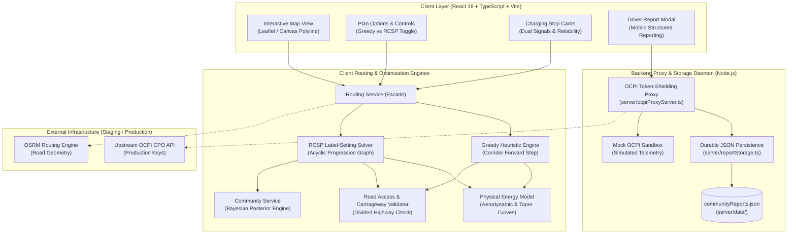
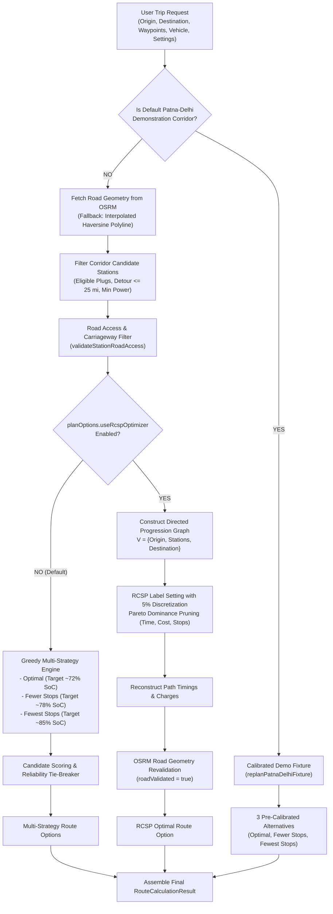
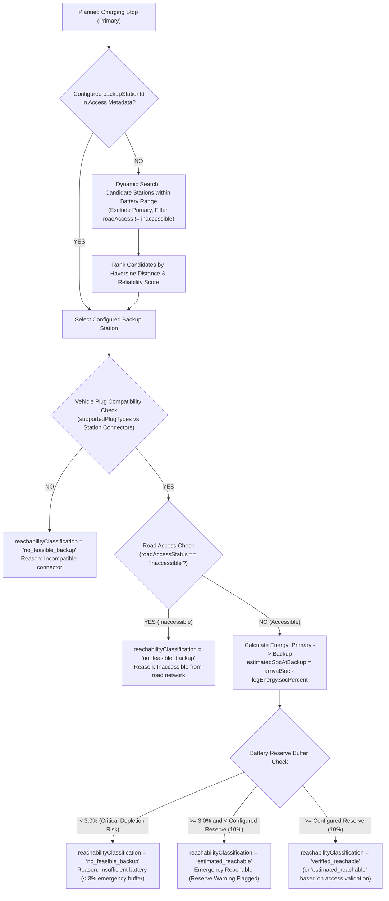

# System Architecture & Technical Specification
## Reliability-Aware Electric Vehicle Route Optimization Platform

This document specifies the software architecture, data flows, graph models, and subsystem interfaces for the India-focused EV Route Planner platform.

---

## 1. High-Level System Architecture

The platform follows a layered, modular architecture decoupling user interactions, routing optimization algorithms, geospatial validation, live network adapters, and participatory community telemetry.



---

## 2. User Trip Request & Routing Engine Data Flow

The routing engine processes user trip inputs through a strict corridor detector, delegating either to the pre-calibrated baseline fixture (Patna–Delhi demo) or the dynamic custom routing engines:



---

## 3. Battery State Transition & Discretized Progression Graph

In the RCSP model, the highway corridor is modeled as an acyclic directed graph $G = (V, E)$, topologically sorted by progression distance along the route.

```mermaid
stateDiagram-v2
    [*] --> Origin: Departure SoC = 95%
    
    Origin --> Station_1: Highway Leg (d1 miles, ΔSoC1)
    note right of Station_1: Arrival SoC = 95% - ΔSoC1 >= 10%<br/>Enumerate Target SoCs: [35%, 40%, ..., 85%]
    
    Station_1 --> Station_2: Highway Leg (d2 miles, ΔSoC2)
    note right of Station_2: Arrival SoC = Target_1 - ΔSoC2 >= 10%<br/>Dominance Test: Prune suboptimal labels
    
    Station_1 --> Destination: Long Range Direct Reachable?
    Station_2 --> Destination: Final Leg (d_dest miles, ΔSoC_dest)
    note right of Destination: Arrival SoC >= Destination Reserve (10%)<br/>Lexicographic Best Label Selection
    
    Destination --> [*]
```

---

## 4. Community Reporting & Verification Lifecycle

```mermaid
sequenceDiagram
    autonumber
    actor Driver as EV Driver (Client)
    participant UI as DriverReportModal
    participant Proxy as Server Daemon (/api/reports)
    participant Store as reportStorage.ts
    participant Engine as communityService.ts
    participant Router as RCSP / Greedy Router

    Driver->>UI: Selects Station & Observed Condition
    UI->>UI: Validates mandatory fields & text length (<= 280 chars)
    UI->>Proxy: HTTP POST /api/reports (with client IP)
    Proxy->>Store: submitCommunityReport(payload, clientIp)
    
    Store->>Store: Keyed HMAC(IP) -> contributorId
    Store->>Store: Check Rate Limit (max 5 req / 10 min)
    Store->>Store: Check Deduplication (30 min window)
    
    alt Duplicate within 30 min by same contributor
        Store-->>Proxy: HTTP 409 Conflict (Duplicate Rejected)
        Proxy-->>UI: Alert: Duplicate submission rejected
    else Independent report within 24h by different contributor
        Store->>Store: Increment corroborationCount (corroborated)
        Store->>Store: Save to server/data/communityReports.json
        Store-->>Proxy: HTTP 201 Created (corroborated status)
        Proxy-->>UI: Success: Report corroborated by community
    else New incident
        Store->>Store: Save new record (published status)
        Store-->>Proxy: HTTP 201 Created
        Proxy-->>UI: Success: Observation recorded
    end

    Note over Engine,Router: On Subsequent Route Calculation
    Router->>Engine: computeStationReliability(reports, stationId, cpoStatus)
    Engine->>Engine: Apply exponential time-decay weights (w_i)
    Engine->>Engine: Beta-binomial posterior mean & confidence tier
    Engine->>Engine: Detect CPO Telemetry vs Community Discrepancies
    Engine-->>Router: StationReliabilitySummary (Score, Confidence, Dual Signal)
    Router->>Driver: Renders ChargingStopCard with Badges & Warnings
```



---

## 5. Backup Charger Decision Flow



